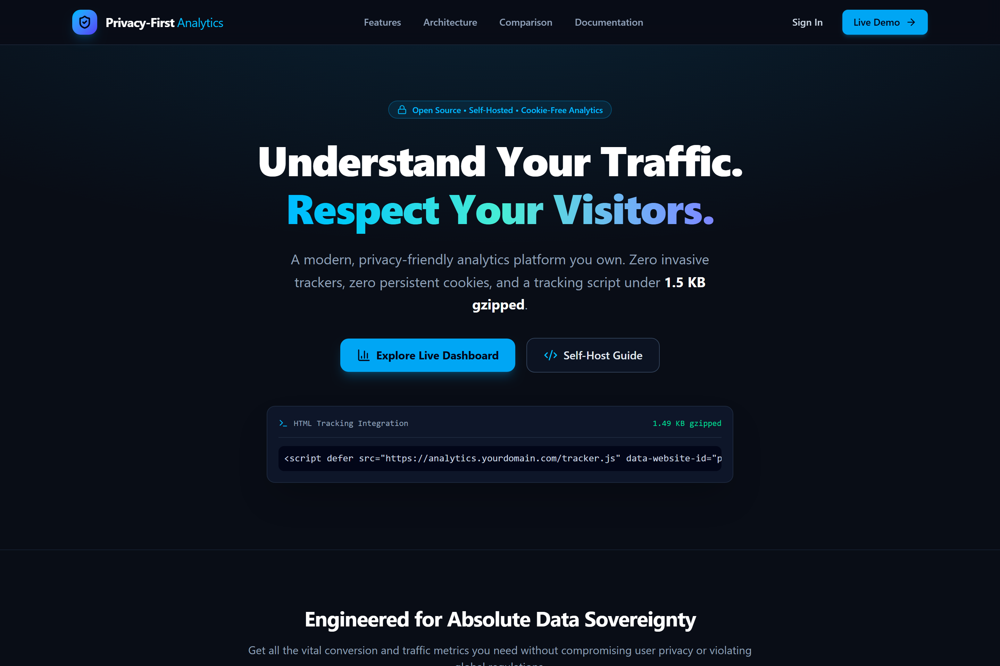
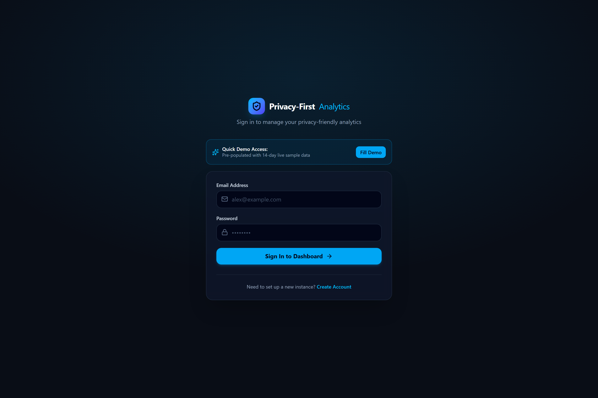
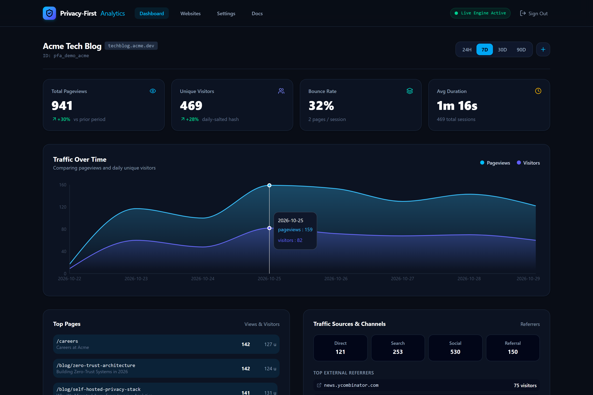
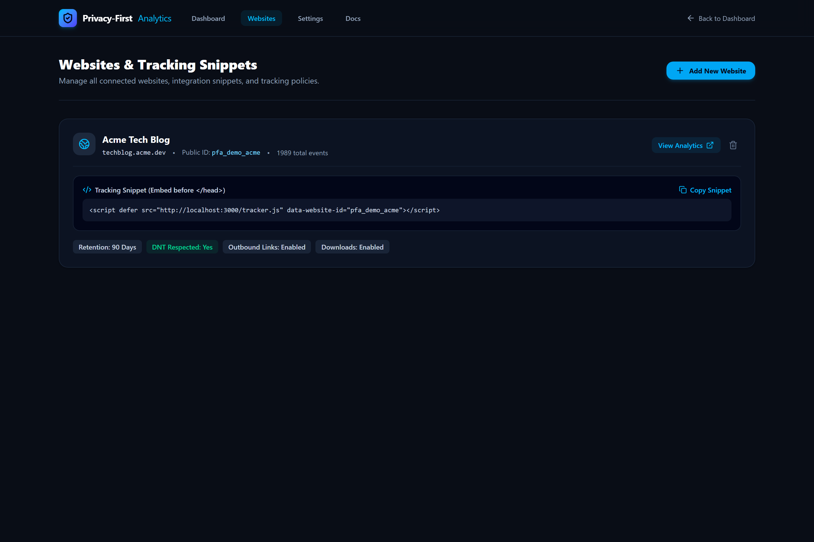
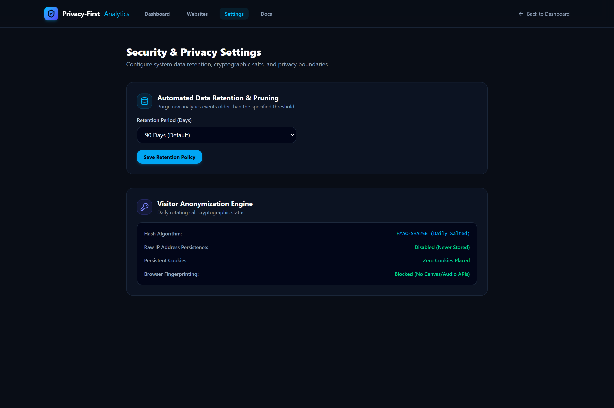
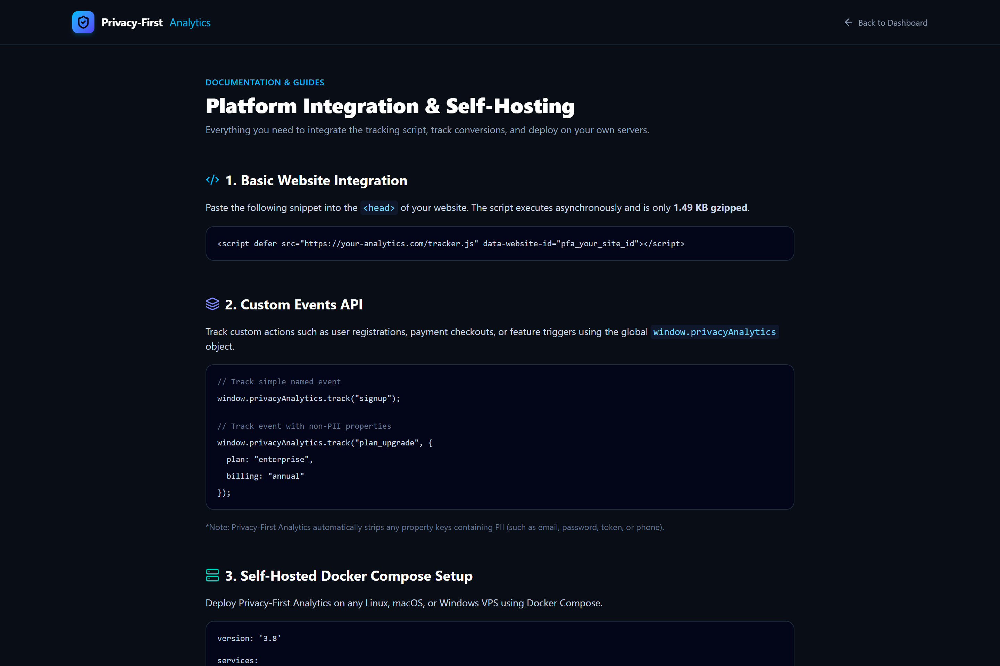

# Privacy-First Analytics — Self-Hosted, Lightweight Website Analytics

> **Understand your traffic. Respect your visitors.**

[](LICENSE)
[](https://nextjs.org/)
[](https://react.dev/)
[](https://tailwindcss.com/)
[](public/tracker.js)
[](docker-compose.yml)
[](tests/)

**Privacy-First Analytics** is a modern, lightweight, open-source alternative to invasive analytics services like Google Analytics and Matomo. Designed specifically for developers, SaaS founders, and organizations that demand full data sovereignty, zero tracking cookies, sub-1.5 KB client payloads, and compliance with GDPR, CCPA, and PECR without needing intrusive consent banners.

---

## 📸 Complete Platform Showcase

### 1. High-Conversion Marketing Landing Page
*Clean, modern landing page highlighting features, architecture, 1-line Docker setup, and direct demo access.*


### 2. Dual-Mode Authentication Gateway & Demo Autofill
*Unified sign-in interface with 1-click test credentials and registration for quick instance evaluation.*


### 3. Interactive Analytics Command Center (`/dashboard`)
*Real-time traffic metrics, interactive timeseries chart, top pages progress bars, traffic channels, device breakdowns, and conversion goals.*


### 4. Multi-Website Management & Tracking Snippets (`/websites`)
*Manage multiple client and portfolio websites with 1-click snippet copying, public IDs, and per-site tracking rules.*


### 5. Security, Data Retention & Cryptographic Salt Settings (`/settings`)
*Configure automated data retention limits, inspect cryptographic daily salt status, and enforce strict PII redaction.*


### 6. Developer Integration & Self-Hosting Guide (`/docs`)
*Comprehensive guide for HTML embedding, Single Page Application routing detection, and custom event tracking.*


---

## 📋 Repository Details & Specifications

| Attribute | Specification |
| :--- | :--- |
| **Repository URL** | [https://github.com/0xyz-exe/privacy-first-analytics](https://github.com/0xyz-exe/privacy-first-analytics) |
| **Maintainer** | `0xyz-exe` ([danielachmadf@gmail.com](mailto:danielachmadf@gmail.com)) |
| **License** | [MIT License](LICENSE) |
| **Visibility** | Public Open Source |
| **Default Branch** | `main` |
| **Architecture** | Unified Modular Monolith (Next.js 16 App Router + Route Handlers) |
| **Frontend Stack** | React 19, TypeScript strict mode, Tailwind CSS v4, Lucide React, Recharts |
| **Backend Engine** | Next.js REST Route Handlers, Zod Payload Validation, Jose JWT Sessions |
| **Database Support** | Dual Engine: High-Throughput SQLite (`node:sqlite` WAL mode) & PostgreSQL |
| **Tracking Engine** | Zero-dependency vanilla JS tracker (`public/tracker.js`), **1.49 KB gzipped** |
| **Privacy Guarantees** | No persistent cookies, no canvas/audio fingerprinting, daily-salted SHA-256 IP hashing, automatic PII parameter stripping |
| **Containerization** | Production Multi-Stage Dockerfile & Docker Compose (`docker-compose.yml`) |
| **Automated Tests** | 100% Passing Vitest Suite (Unit, Privacy Engine, Anonymization, Analytics Math) |
| **GitHub Topics** | `web-analytics`, `privacy-first`, `self-hosted`, `gdpr-compliant`, `cookie-free`, `nextjs`, `react19`, `typescript`, `docker`, `open-source` |

---

## ⚡ Core Privacy Architecture

```
                    ┌───────────────────────────────┐
                    │  Visitor Browser (Client)     │
                    │  - No persistent cookies      │
                    │  - Tracker script: 1.49 KB    │
                    │  - Respects DNT & Sec-GPC     │
                    └──────────────┬────────────────┘
                                   │ Beacon (POST /api/v1/collect)
                                   ▼
                    ┌───────────────────────────────┐
                    │  Event Sanitization Pipeline  │
                    │  - Strips PII query tokens    │
                    │  - Sanitizes custom events    │
                    │  - Coarse device detection    │
                    └──────────────┬────────────────┘
                                   │
                                   ▼
                    ┌───────────────────────────────┐
                    │  Cryptographic Hash Function  │
                    │  SHA-256(IP + SiteID + Date)  │
                    │  Raw IP instantly discarded!  │
                    └──────────────┬────────────────┘
                                   │
                                   ▼
                    ┌───────────────────────────────┐
                    │  Storage & Aggregation Engine │
                    │  - SQLite (WAL) / PostgreSQL  │
                    │  - Real-time time-series      │
                    │  - Auto-retention pruning     │
                    └───────────────────────────────┘
```

1. **Daily Rotating Salt:** Unique visitors are identified by hashing `SHA256(Client_IP + Website_ID + YYYY-MM-DD + Salt)`. Raw IP addresses are **never written to disk**.
2. **Zero Cross-Site Tracking:** The hash incorporates the `Website_ID`, ensuring visitors cannot be correlated across different domains.
3. **No Fingerprinting:** Canvas, WebGL, AudioContext, and font enumeration APIs are strictly forbidden.
4. **Lightweight Tracker:** Core tracking script compiles to 4.12 KB uncompressed and **1.49 KB gzipped**.

---

## 🚀 Quick Start Guide

### Option 1: Docker Compose (Production Ready)

```bash
git clone https://github.com/0xyz-exe/privacy-first-analytics.git
cd privacy-first-analytics
cp .env.example .env
docker compose up -d
```

Visit `http://localhost:3000`.

---

### Option 2: Local Development

```bash
# 1. Install dependencies
pnpm install

# 2. Seed database with realistic demo traffic
pnpm seed

# 3. Run test suite
pnpm test

# 4. Start local development server
pnpm dev
```

Default demo credentials:
- **Email:** `demo@privacyanalytics.dev`
- **Password:** `password123`

---

## 🛠️ Client Integration & Usage

### 1. Standard HTML Integration

Embed before the closing `</head>` tag:

```html
<script defer src="https://analytics.yourdomain.com/tracker.js" data-website-id="pfa_your_site"></script>
```

### 2. Custom Events API

```javascript
// Track button click or feature trigger
window.privacyAnalytics.track("signup");

// Track with non-PII properties
window.privacyAnalytics.track("upgrade_plan", {
  plan: "pro",
  interval: "monthly"
});
```

---

## 🧪 Testing & Validation

```bash
# Run unit & privacy engine test suite
pnpm test

# Run production build validation
pnpm build
```

---

## 📜 License

Distributed under the [MIT License](LICENSE).
